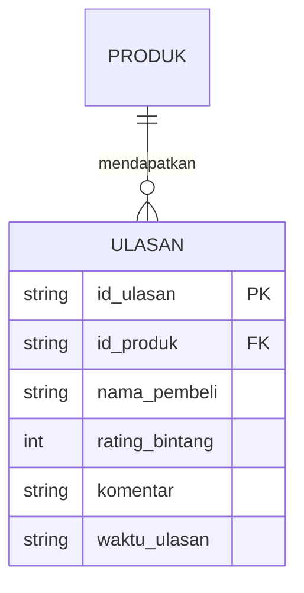

# Tugas Mandiri 02d — Model Data Fitur Ulasan Produk
Nama: Gusti Dimas Achmad

## 1. Struktur Entitas Baru: ULASAN

## 2. Penjelasan Relasi & Kunci:
- **Relasi:** Satu ke Banyak (`1 : N`). Satu `PRODUK` bisa mendapatkan banyak `ULASAN` dari berbagai pembeli (atau 0 ulasan jika belum ada yang mengulas, sehingga memakai simbol `||--o{`), tetapi satu baris `ULASAN` hanya tertuju pada satu produk tertentu.
- **Kunci Tamu (FK):** Atribut `id_produk` pada tabel `ULASAN` berfungsi sebagai Foreign Key yang menunjuk ke `id_produk (PK)` milik entitas `PRODUK`.