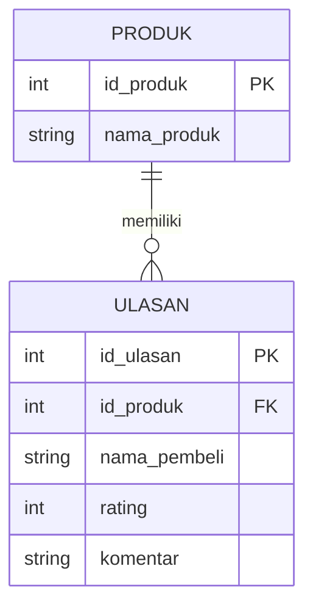

# Tugas Mandiri 02d — Perancangan Entitas ULASAN

**Nama:** Husain Fadhilah Amal

## 1. Daftar Atribut Entitas ULASAN

Entitas `ULASAN` digunakan untuk menyimpan penilaian dan komentar dari pembeli terhadap produk yang mereka beli.

| Atribut | Tipe Data | Keterangan |
|---|---|---|
| id_ulasan | int | **PK** — Identitas unik setiap ulasan |
| id_produk | int | **FK** — Menghubungkan ulasan dengan produk |
| nama_pembeli | string | Nama pembeli yang memberikan ulasan |
| rating | int | Penilaian produk dari 1 sampai 5 bintang |
| komentar | string | Isi komentar pembeli |

## 2. Relasi Entitas PRODUK dengan ULASAN

Relasi antara `PRODUK` dan `ULASAN` adalah **One to Many (1:N)**.

Artinya:
- Satu produk bisa memiliki banyak ulasan dari pembeli yang berbeda.
- Satu ulasan hanya ditujukan untuk satu produk.
- `id_produk` pada tabel ULASAN menjadi Foreign Key (FK) yang menghubungkan kedua entitas.

**Contoh:**

Produk bernama Mi Ayam bisa memiliki 3 ulasan:

1. Pembeli A memberikan 5 bintang.
2. Pembeli B memberikan 4 bintang.
3. Pembeli C memberikan 3 bintang.

Ketiga ulasan tersebut memiliki `id_produk` yang sama, tetapi `id_ulasan` berbeda.

## 3. Kode Mermaid ERD

## 4. Kesimpulan

Entitas ULASAN berfungsi untuk menyimpan penilaian dan komentar pembeli terhadap produk. Relasinya adalah 1:N karena satu produk dapat memiliki banyak ulasan, sedangkan satu ulasan hanya berhubungan dengan satu produk. Dengan adanya fitur ini, pembeli lain bisa melihat pengalaman pembeli sebelumnya sebelum memilih produk.