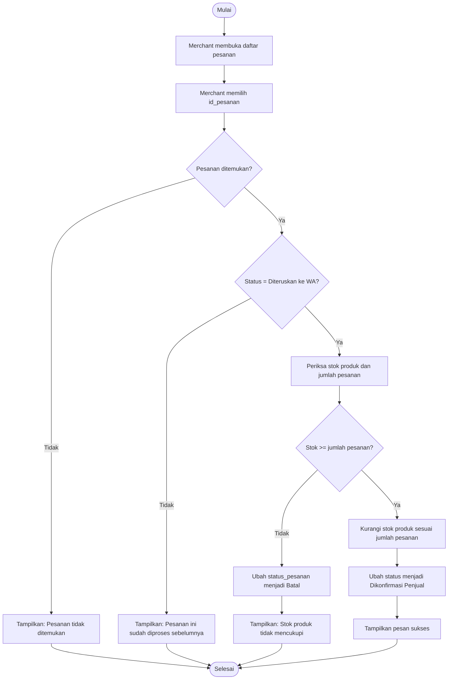
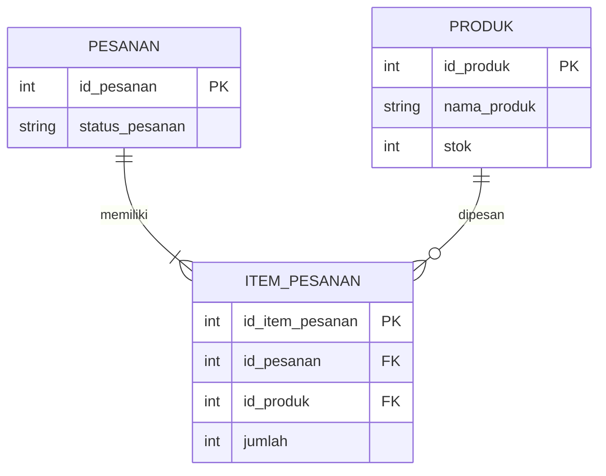

# Blueprint Fitur Terpadu
## Opsi A — Konfirmasi Pesanan WA oleh Merchant & Potong Stok Otomatis

Nama: Husain Fadhilah Amal

## 1. Dekomposisi Masalah

Berikut langkah-langkah proses konfirmasi pesanan oleh merchant:

1. Merchant membuka daftar pesanan di dashboard.
2. Merchant memilih ID pesanan yang ingin dikonfirmasi.
3. Sistem memeriksa apakah status pesanan masih "Diteruskan ke WA".
4. Jika status tidak sesuai, sistem menolak konfirmasi dan menampilkan pesan kesalahan.
5. Sistem memeriksa apakah stok produk mencukupi jumlah pesanan.
6. Jika stok tidak mencukupi, pesanan dibatalkan dan sistem menampilkan peringatan.
7. Jika stok mencukupi, sistem mengurangi stok produk, mengubah status pesanan menjadi "Dikonfirmasi Penjual", dan menampilkan pesan sukses.

## 2. Pseudocode

```text
MULAI

TAMPILKAN daftar_pesanan

INPUT id_pesanan

CARI pesanan berdasarkan id_pesanan

JIKA pesanan tidak ditemukan MAKA
    TAMPILKAN "Pesanan tidak ditemukan"

LAINNYA
    JIKA status_pesanan != "Diteruskan ke WA" MAKA
        TAMPILKAN "Pesanan ini sudah diproses sebelumnya"

    LAINNYA
        PERIKSA stok_produk >= jumlah_pesanan

        JIKA stok_produk < jumlah_pesanan MAKA
            status_pesanan = "Batal"
            TAMPILKAN "Gagal konfirmasi: Stok produk tidak mencukupi"

        LAINNYA
            stok_produk = stok_produk - jumlah_pesanan
            status_pesanan = "Dikonfirmasi Penjual"
            TAMPILKAN "Pesanan berhasil dikonfirmasi"

        AKHIR-JIKA
    AKHIR-JIKA
AKHIR-JIKA

SELESAI
```

## 3. Flowchart



## 4. Potongan ERD

Entitas yang digunakan dalam fitur ini adalah PESANAN, ITEM_PESANAN, dan PRODUK.



## 5. Tabel Audit Konsistensi

| No. | Variabel / Kondisi | Pseudocode | Flowchart | ERD | Status |
|---|---|---|---|---|---|
| 1 | `id_pesanan` | INPUT dan pencarian pesanan | Memilih ID pesanan | Ada di PESANAN | Sesuai |
| 2 | `status_pesanan` | Memeriksa dan mengubah status | Pengecekan dan perubahan status | Ada di PESANAN | Sesuai |
| 3 | `stok` | Memeriksa dan mengurangi stok | Pengecekan dan pengurangan stok | Ada di PRODUK | Sesuai |
| 4 | `jumlah` | Membandingkan dengan stok | Pengecekan jumlah pesanan | Ada di ITEM_PESANAN | Sesuai |
| 5 | `id_produk` | Menghubungkan item dengan produk | Mengambil produk yang dipesan | Ada di ITEM_PESANAN dan PRODUK | Sesuai |

## 6. Kesimpulan

Fitur ini membantu merchant mengelola konfirmasi pesanan dengan lebih teratur.

Sistem akan memeriksa status pesanan dan ketersediaan stok sebelum melakukan konfirmasi. Jika stok mencukupi, stok otomatis berkurang dan status pesanan berubah menjadi "Dikonfirmasi Penjual". Jika stok tidak mencukupi, pesanan dibatalkan.

Dengan adanya fitur ini, risiko menerima pesanan melebihi stok yang tersedia dapat dikurangi.